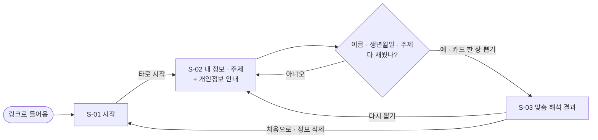
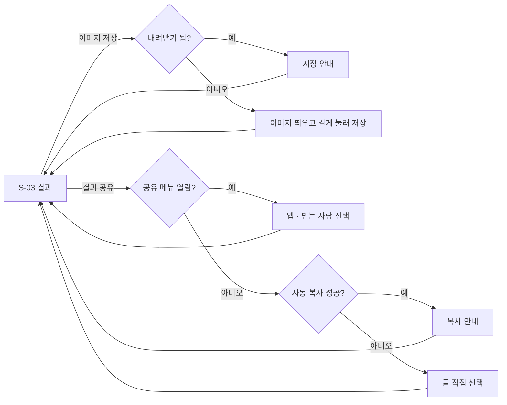

# 타로카드 유저플로우

## 나만의 타로 보기 (시나리오 1 · 3)

## 저장 · 공유 (시나리오 2)

- 결과를 보면 핵심 이용 끝. 저장 · 공유는 선택. (F-1~F-4)
- 받은 사람은 링크로 S-01에 들어와 자기 정보를 넣는다. 링크에는 이름 · 결과가 없다. (F-6 · 원칙 5)
- 창을 닫거나 [처음으로]를 누르면 입력 정보가 지워진다. (F-7 · 원칙 1)
